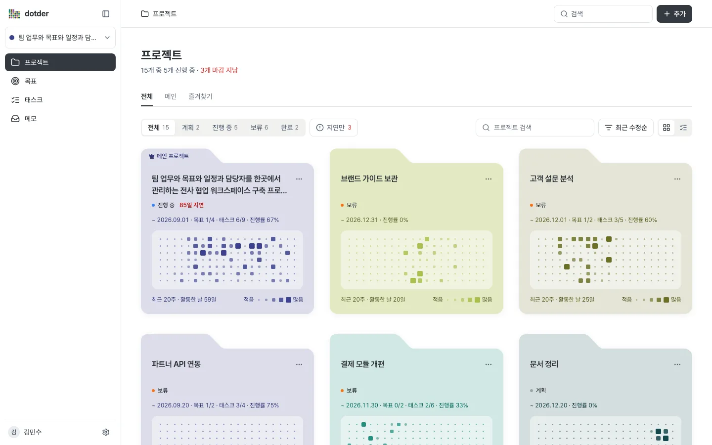
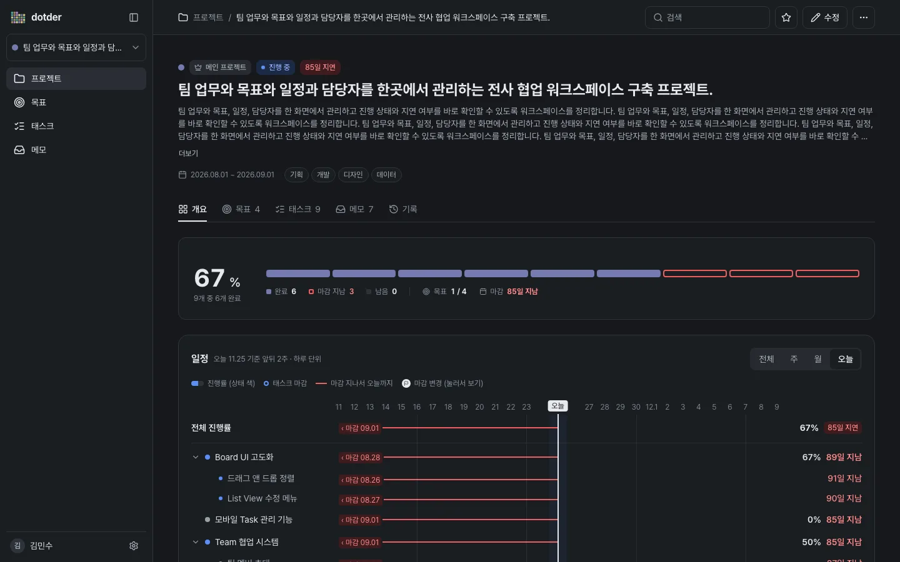

# Dotder

할 일 하나하나를 조각처럼 남기고, 그것을 이어 나만의 프로젝트와 기록을 만드는 **개인 프로젝트 기록 앱**입니다.
프로젝트 · 목표 · 태스크 · 메모를 따로 만들고, 필요할 때 서로 연결합니다.

**Live:** [https://dotder.vercel.app](https://dotder.vercel.app)

> 지금은 서버 없이 예시 데이터로 동작합니다. 새로고침하면 처음 상태로 돌아갑니다.





## 주요 기능

- **프로젝트 · 목표 · 태스크 · 메모**: 넷을 따로 만들고 서로 연결합니다. 프로젝트 상세에는 개요 · 목표 · 태스크 · 메모 · 기록 탭이 있습니다.
- **진행률과 일정 한눈에 보기**: 개요 탭에서 진행률과 지연 여부를 보여 주고, 목표와 태스크의 마감을 일정 막대로 보여 줍니다.
- **태스크 보기 3가지**: 보드 · 목록 · 캘린더로 볼 수 있습니다. 보드에서는 태스크를 끌어다 놓아 상태를 바꿉니다.
- **날짜 범위 규칙과 변경 기록**: 태스크 마감은 목표 마감을, 목표 마감은 프로젝트 마감을 넘지 않습니다. 프로젝트 기간을 바꾸면 범위를 벗어나는 목표 · 태스크를 같이 옮길 수 있고, 바뀐 내용은 기록 탭에 남습니다.
- **예시로 둘러보기**: 첫 화면에서 안내 말풍선을 따라 주요 화면을 둘러볼 수 있습니다.

## 사용 기술

- [Next.js](https://nextjs.org) 16 (App Router) · React 19 · TypeScript
- Tailwind CSS 4: 색 · 간격 · 크기를 CSS 변수 토큰으로 관리
- TanStack Query: 데이터 읽기와 저장
- lucide-react: 아이콘
- ESLint · Prettier

## 신경 쓴 점

- **반응형**: 웹 · 태블릿 · 모바일 화면을 따로 설계했습니다. 웹은 접을 수 있는 사이드바, 모바일은 메뉴 버튼으로 엽니다.
- **라이트 · 다크 모드**: 라이트 · 다크 · 시스템 설정 중에서 고를 수 있습니다. 페이지가 그려지기 전에 테마를 적용해 화면이 깜빡이지 않습니다.
- **키보드 사용**
  - 드로어와 팝오버가 열리면 초점이 안에 머물고, Esc로 닫으면 연 버튼으로 초점이 돌아옵니다.
  - 단축키: `⌘K` 검색, `G` 다음 `P`·`G`·`T`·`M` 메뉴 이동, `Shift+N` 메모 빠른 입력, `[` 사이드바 접기, `↑`·`↓` 줄 이동, `X` 완료, `?` 단축키 도움말.
- **접근성**: 아이콘만 있는 버튼에 이름(`aria-label`)을 붙였고, 키보드 초점을 링으로 보여 줍니다. 기기에서 움직임 줄이기를 켜면 첫 화면 애니메이션을 멈춥니다.

## 실행 방법

Node.js와 npm이 필요합니다.

```bash
npm install
npm run dev
```

브라우저에서 [http://localhost:3000](http://localhost:3000)을 엽니다.

환경 변수는 필요하지 않습니다. 그래서 `.env.example` 파일도 없습니다.

| 명령 | 하는 일 |
|---|---|
| `npm run dev` | 개발 서버 |
| `npm run build` · `npm start` | 배포용 빌드 · 실행 |
| `npm run lint` | ESLint 검사 |
| `npm run format:check` | Prettier 검사 |
